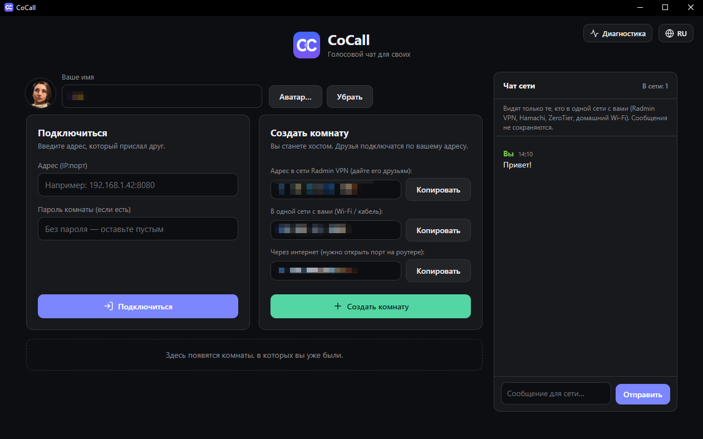
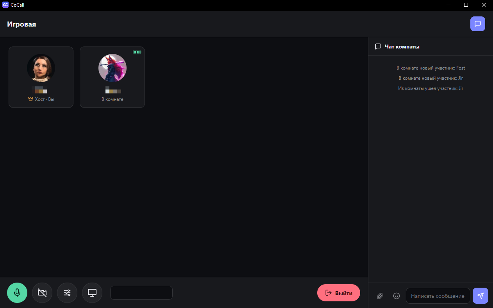
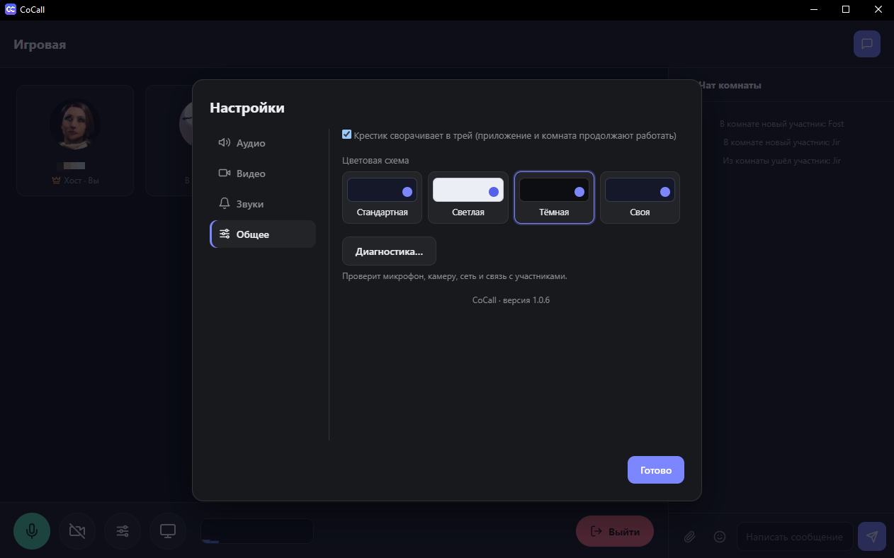

<div align="center">

# CoCall

**Voice chat for your own crowd.** No sign-up, no cloud: one of you creates a room on their own computer, the others join by address.

[](https://github.com/vovaeiffel/CoCall/releases/latest)
[](LICENSE)


[Русский](README.md) · **English**

</div>



> The screenshots show the Russian interface; the app also has an English one (the globe button in the top right corner).

CoCall (short for "community call") is a desktop app for voice chat in a small group: gaming with friends, a work call, hanging out. Voice, camera and screen go directly between participants (P2P), so there is no server, no accounts and no subscription. It works best when everyone is on the same virtual local network, for example [Radmin VPN](https://www.radmin-vpn.com/).

## Features

- **Voice** with RNNoise neural noise suppression (removes keyboard, fan and hum), a microphone activation threshold and a mute hotkey.
- **Screen sharing** at 1080p, 720p or 480p. Viewers click "Watch" themselves, so no bandwidth is wasted.
- **Webcam** at 360p, 480p or 720p (up to 4 cameras in a room at once).
- **Room chat** with images, emoji and file sending up to 50 MB.
- **Network chat** on the main screen: talk to people on the same network as you without joining a room.
- **Nearby rooms**: a room created on your network shows up on everyone else's main screen by itself.
- **Keeps the room alive**: if the connection drops, the app reconnects on its own, and if the host loses their internet, the host role moves to another participant (when participants can reach each other directly).
- **Conveniences**: avatars, pinning a participant, a connection quality indicator for each person, per-person volume (up to 400%), minimize to tray, room password.
- **Look and feel**: sound packs and custom event sounds, color schemes (standard, light, dark and custom), Russian and English interface.
- **Diagnostics**: one button checks your microphone, speakers, camera, network and the link to each participant, and tells you what to do.
- **Auto-update**: new versions download and install from inside the app.

<p align="center">
  
  
</p>

## Download and install

1. Open the [releases page](https://github.com/vovaeiffel/CoCall/releases/latest) and download `CoCall-Setup-….exe`.
2. Run the installer. It installs without administrator rights and keeps your settings across updates.
3. Windows may show a blue "Windows protected your PC" window: the installer is not signed with a paid certificate. Click "More info" → "Run anyway". Antivirus software sometimes complains about unsigned programs too. That is a false alarm, but you are welcome to check for yourself: all the code is open and you can [build the app yourself](docs/en/building.md).

## Quick start

1. Everyone installs CoCall and joins the same virtual network (for example, Radmin VPN).
2. One of you clicks **"Create room"**, picks a name and (optionally) a password.
3. The others see the room on the main screen under "Rooms on your network", or type an address like `26.1.2.3:8080`, which can be copied from the host.

More: [Getting started](docs/en/getting-started.md) and [Virtual networks](docs/en/network.md).

## Documentation

| Section | What it covers |
| --- | --- |
| [Getting started](docs/en/getting-started.md) | installing, the first room, joining, updating |
| [Virtual networks](docs/en/network.md) | Radmin VPN, Hamachi, ZeroTier, addresses and ports |
| [Features](docs/en/features.md) | voice, screen sharing, camera, chats and settings in detail |
| [Troubleshooting](docs/en/troubleshooting.md) | diagnostics and common problems |
| [Privacy and limits](docs/en/privacy-and-limits.md) | what is sent and how, what the app can't do |
| [Building and development](docs/en/building.md) | building the app, making a release, adding a language |

## Honest notes

- **Windows only.** The installer is built and tested on Windows. Other systems have not been tested.
- **Up to 8 people per room.** Everyone connects to everyone directly, so big rooms run into bandwidth limits.
- **Built around a shared network.** The main features are designed for a virtual local network. A room can also work over a public internet address, but then the host must open a port on their router, which doesn't always work. Network chat and automatic room discovery only work inside a shared network.
- **Screen sharing audio.** If "share computer sound" is on, your friends' voices end up in the stream too (the app can't exclude its own sound yet). Workarounds: untick "share computer sound", or use different output devices for voice chat and the game.
- **Chat is not encrypted.** Voice, camera and screen are encrypted by WebRTC. Messages, files and avatars go through the host's computer over a plain WebSocket without encryption, and the room password only keeps strangers out. Details: [Privacy and limits](docs/en/privacy-and-limits.md).
- **Participants can see each other's IP addresses.** This comes with direct connections.
- **A hobby project.** It's made by one person and grows bit by bit. Bugs are possible. If you find one, [open an issue](https://github.com/vovaeiffel/CoCall/issues).

## Building from source

```
npm install
npm start        # run for development
npm run dist     # build the installer (the release folder)
```

More: [docs/en/building.md](docs/en/building.md).

## Credits

- [Electron](https://www.electronjs.org/), [ws](https://github.com/websockets/ws), [electron-builder](https://www.electron.build/) and electron-updater.
- [RNNoise](https://gitlab.xiph.org/xiph/rnnoise) (Xiph.Org Foundation) — neural noise suppression.

## License

[MIT](LICENSE) © 2026 vovaeiffel
