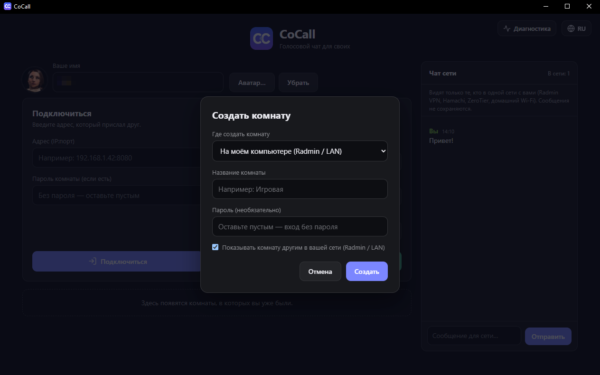

# Getting started

[← Back to the contents](../../README.en.md)

> The screenshots show the Russian interface. Switch the language with the globe button in the top right corner of the main screen.

## 1. Installing

1. Download `CoCall-Setup-….exe` from the [releases page](https://github.com/vovaeiffel/CoCall/releases/latest).
2. Run it. If Windows shows the blue "Windows protected your PC" window, click "More info" → "Run anyway". This happens with every program that isn't signed with a paid certificate.
3. The app installs for your own account (no administrator rights needed). You can choose the install folder. A CoCall shortcut appears on the desktop and in the Start menu.

The installed app can't be started twice: launching it again just brings the open window forward.

## 2. First launch

1. Type your **name** into "Your name". Others will see it. Without a name you can't join a room or write in the network chat.
2. Optionally pick an **avatar** with the "Avatar…" button (the picture is shrunk to a small square; "Remove" brings back the colored circle with a letter).
3. If you like, choose a language (the globe button in the top right) and a color scheme (Settings → General).

The app asks for the microphone when you enter a room.

## 3. Creating a room

Click **"Create room"**. In the window:

- **Where to create the room**: "On my computer (Radmin / LAN)". Your computer becomes the host: the room's "server" runs on it.
- **Room name** — anything you like.
- **Password** — optional. It only keeps out people who don't know it.
- **Show the room to others on your network** — when ticked, the room appears on everyone else's main screen by itself (works inside one network, see [Virtual networks](network.md)).

Give your friends an address. The "Create room" block on the main screen shows your computer's addresses:

| Label | When to use it |
| --- | --- |
| "Address on the Radmin VPN network" | friends on the same Radmin VPN network as you (the most common case) |
| "On your network (Wi-Fi / cable)" | friends on your home network |
| "Over the internet" | friends outside your network, but only if you opened a port on your router. It doesn't always work |

The "Copy" button copies an address like `26.1.2.3:8080`.

## 4. Joining a room

Way 1 (easiest): open the main screen. If you're on the same network as the host and the host chose to show the room, it appears in the "Rooms on your network" list. Click "Connect". If the room has a password, type it into "Room password" first.

Way 2: paste the host's address into "Address (IP:port)", type the password if there is one, and click "Connect".

Rooms you've been in are remembered and shown on the main screen under "Rooms you have visited", with a mark of whether the room is running right now. Your own room is shown under "Your room": "Enter" takes you back into it and "Close room" closes it for everyone.

## 5. In the room

The buttons at the bottom: microphone, camera, settings, screen sharing and "Leave". The room chat is on the right. Everything in detail: [Features](features.md).

The host can leave the voice part while the room stays alive as long as the host's app is open. The "Enter" button lets them come back. If the host closes the window with the cross, the app minimizes to the tray (the icon near the clock) by default and the room keeps running. You can turn that off in Settings → General.

## 6. Updating

When a new version comes out, a banner appears at the top:

1. "Download and install" starts the download with a percentage.
2. "Restart and install" closes the app and starts it again as the new version. If you were in a room, you leave it.

If you don't click the button, the downloaded update installs itself the next time you quit the app. If auto-update fails, the button turns into "Download manually" and opens the releases page.

**Important:** for all features to work the same, everyone in a room should have the same version. Update together.
